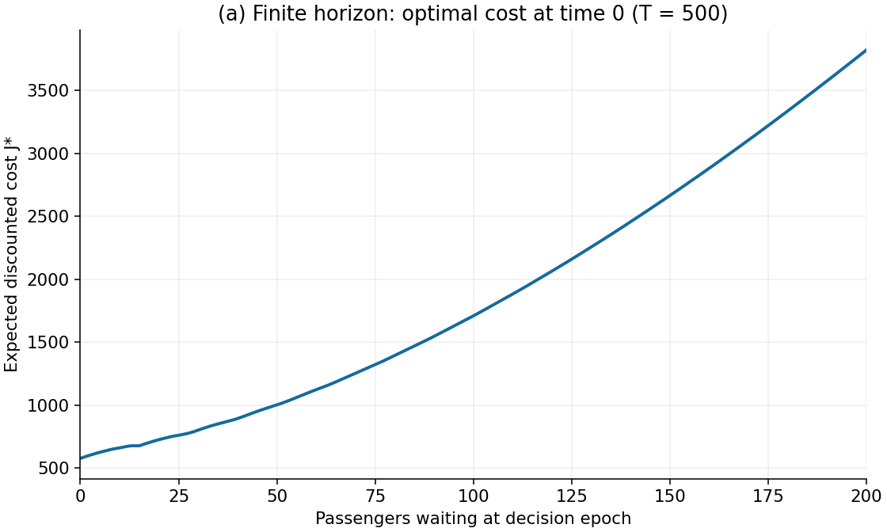
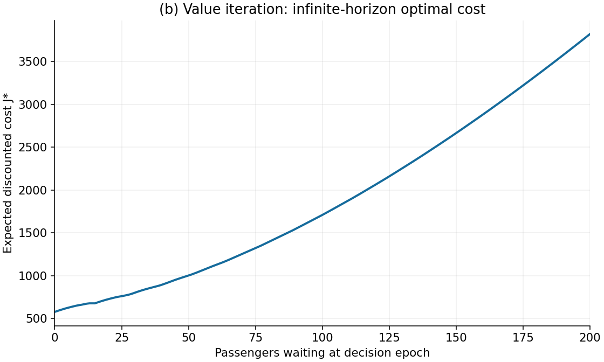
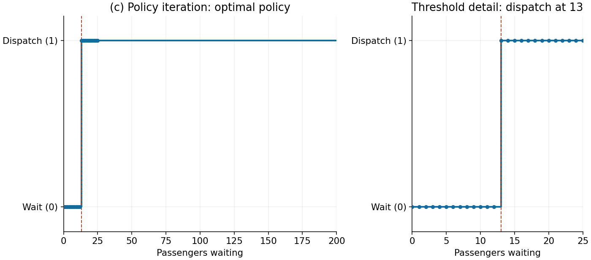
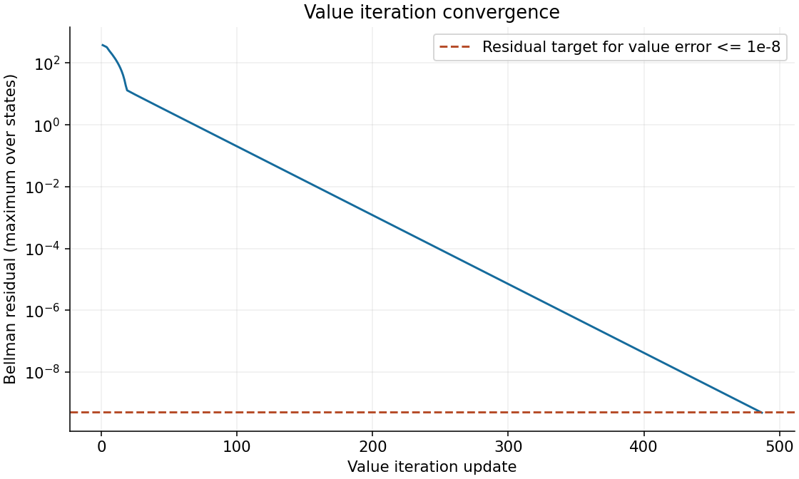

# First question: value and policy iteration for shuttle dispatching

All results below use the specified parameters
\(K=15\), \(c_f=100\), \(c_h=2\), \(\gamma=0.95\), and uniform integer arrivals
on \(\{1,2,3,4,5\}\). Computed values are **expected discounted costs**; smaller
is better. In a reward-maximization convention, define \(r=-c\) and \(V=-J\).

## MDP and explicit assumptions

The state \(s_t\in\{0,1,\ldots,200\}\) is the number of passengers waiting
immediately before the dispatch decision. Action \(a_t=0\) waits and \(a_t=1\)
dispatches one shuttle. A partially filled shuttle is allowed. Dispatch removes
\(\min(s_t,K)\) passengers, so the queue immediately after service is

\[
q(s,a)=\max(s-aK,0).
\]

Each period follows this order: observe the queue, decide whether to dispatch,
remove passengers, charge the dispatch and holding costs, and then add arrivals.
Thus new arrivals join the next decision epoch and do not incur the current
period's holding cost. The one-period cost is

\[
c(s,a)=c_f a+c_hq(s,a)=100a+2\max(s-15a,0).
\]

Arrivals are assumed independent and identically distributed across periods,
independent of decisions. The transition is

\[
s_{t+1}=\min\{200,q(s_t,a_t)+A_t\},
\qquad \Pr(A_t=k)=\tfrac15,\ k=1,\ldots,5.
\]

Equivalently,

\[
P(s'\mid s,a)=\frac15\sum_{k=1}^{5}
\mathbf{1}\{s'=\min(200,q(s,a)+k)\}.
\]

The queue limit is modeled as a hard station capacity: excess arrivals are turned
away without an additional penalty or outside backlog. The assignment does not
specify an overflow rule, so this is an explicit modeling assumption. A new
shuttle is available at each epoch; vehicle availability and travel time impose
no additional constraints. These assumptions make queue length a sufficient
Markov state.

For the finite-horizon problem, \(T=500\) means decisions at times
\(0,\ldots,499\), followed by terminal cost \(J_{500}(s)=0\). No forced final
clearing or penalty for passengers remaining at termination is added. Exact
action ties select wait. The infinite-horizon objective is

\[
J^*(s)=\min_\pi\mathbb E_s^\pi
\left[\sum_{t=0}^{\infty}\gamma^t c(s_t,a_t)\right].
\]

## (a) Enumeration for 500 periods

For the 500-period problem, I used backward induction, evaluating both actions
and all five arrival outcomes at every state and time. This preserves the
ability to adapt future actions to observed arrivals.
Enumerating only predetermined sequences of actions would instead solve an
open-loop problem. Expanding every full decision tree for 500 periods would be
intractable; backward induction reuses identical state-time subproblems.

Starting with \(J_{500}(s)=0\), calculate, for \(t=499,\ldots,0\),

\[
Q_t(s,a)=100a+2q(s,a)+\frac{0.95}{5}
\sum_{k=1}^{5}J_{t+1}(\min(200,q(s,a)+k)),
\]

\[
J_t(s)=\min_{a\in\{0,1\}}Q_t(s,a),
\qquad \pi_t(s)\in\arg\min_a Q_t(s,a).
\]

This requires \(500\cdot201\cdot2\cdot5=1{,}005{,}000\) action-outcome
evaluations. The implementation saves the value and policy at every time.



**Figure 1.** Optimal discounted cost at time 0 for every initial queue size,
with 500 remaining decisions and zero terminal cost.

## (b) Infinite-horizon value iteration

The Bellman operator is

\[
(\mathcal TJ)(s)=\min_{a\in\{0,1\}}
\left\{100a+2q(s,a)+\frac{0.95}{5}
\sum_{k=1}^{5}J(\min(200,q(s,a)+k))\right\}.
\]

Initialize \(J^{(0)}=0\) and synchronously update
\(J^{(n+1)}=\mathcal TJ^{(n)}\). I stop when the Bellman residual of the
**returned** value satisfies

\[
\|\mathcal TJ-J\|_\infty\le(1-\gamma)10^{-8}=5\times10^{-10}.
\]

The discounted Bellman operator is a \(\gamma\)-contraction: averaging cannot
increase the maximum difference between two value vectors, multiplication by
\(\gamma\) shrinks it, and taking a minimum preserves this bound. Therefore

\[
\|J-J^*\|_\infty\le
\frac{\|\mathcal TJ-J\|_\infty}{1-\gamma}.
\]

Convergence took **487 updates**. The final residual was
\(4.8203\times10^{-10}\), giving a value-error bound of
\(9.6406\times10^{-9}\), apart from floating-point rounding.



**Figure 2.** Infinite-horizon optimal discounted cost from value iteration.
Figures 1 and 2 look identical because their maximum numerical difference is
negligible at this plotting scale.

## (c) Policy iteration

Start with the all-wait policy. For a fixed policy \(\pi\), form its transition
matrix \(P_\pi\) and cost vector \(c_\pi\), and solve

\[
(I-0.95P_\pi)J_\pi=c_\pi.
\]

This system is invertible because \(\gamma<1\) and \(P_\pi\) is stochastic.
Improve the action at every state using the Bellman action values evaluated at
\(J_\pi\), and repeat until the policy is unchanged. All 201 states are
optimized without imposing a threshold structure.

The algorithm used **6 policy evaluations**; the numbers of changed actions
after those evaluations were 196, 28, 22, 7, 1, and 0. The resulting policy is

\[
\boxed{\pi^*(s)=
\begin{cases}
0 & 0\le s\le12,\\
1 & 13\le s\le200.
\end{cases}}
\]



**Figure 3.** Optimal policy over the full state space, with a close-up of the
dispatch boundary. Queue lengths are integers; connecting steps are visual aids.

The optimal policy dispatches before the shuttle is full because the objective
balances the fixed dispatch cost against current and future waiting costs.
Let \(\Delta(s)=Q(s,0)-Q(s,1)\); a positive difference favors dispatch. At
12 passengers, waiting is cheaper by 3.778004; at 13, dispatching is cheaper by
4.099663. The smallest absolute action gap over all states is 3.778004. These
gaps are much larger than the numerical error.

| Initial passengers | Finite-horizon cost at time 0 | Infinite-horizon cost | Infinite-horizon action |
|---:|---:|---:|:---|
| 0 | 576.670168 | 576.670168 | Wait |
| 12 | 672.892163 | 672.892163 | Wait |
| 13 | 676.670168 | 676.670168 | Dispatch |
| 15 | 676.670168 | 676.670168 | Dispatch |
| 50 | 1001.527732 | 1001.527732 | Dispatch |
| 100 | 1709.042541 | 1709.042541 | Dispatch |
| 200 | 3821.586477 | 3821.586477 | Dispatch |

The plateau at states 13, 14, and 15 is expected: dispatch empties the station,
costs 100, and gives the same next-state distribution. In particular,
\(J^*(13)=J^*(14)=J^*(15)=100+J^*(0)\).

## Edge cases and the evidence used to check them

| Edge case | Expected behavior and handling | Quantitative check |
|:---|:---|:---|
| Empty station | Dispatch serves nobody and adds 100; wait is optimal. | \(Q(0,0)-Q(0,1)=-100\). |
| Partial shuttle and exact capacity | Serve \(\min(s,15)\), allow empty seats, and never create negative queues. | States 13, 14, and 15 all have cost 676.670168 and dispatch. |
| Queue above shuttle capacity | A single action serves at most 15, rather than clearing the station. | At state 200, dispatch leaves 185, costs \(100+2(185)=470\), and the next state is 186 through 190. |
| Upper boundary | Aggregate all arrival probability that maps to the cap. | Waiting at 198 leads to 199 with probability 0.2 and to 200 with probability 0.8; waiting at 200 stays at 200 with probability 1. |
| Finite-horizon termination | Use zero terminal value and allow time-dependent decisions. | At time 499, wait in all 201 states: dispatch saves at most 30 holding cost but costs 100. |
| Numerical convergence and ties | Check Bellman residual on the returned vector; choose wait on exact ties. | Baseline minimum action gap is 3.778004; VI and PI agree at all 201 states. Free dispatch at an empty station creates a genuine tie and selects wait. |
| No arrivals | Discounting and absence of a service deadline may make indefinite waiting optimal for a tiny queue. | Exact costs for states 0, 1, 2, 3 are 0, 40, 80, 100; wait at 1 and 2 and dispatch at 3. |
| Degenerate economic regimes | Zero holding cost favors waiting; free service favors dispatch; zero discount removes all future benefits. | These analytical predictions pass across the state space; details below. |
| Policy shape under changed parameters | Discover each action rather than requiring a threshold in advance. | With \(K=5\), dispatch at 5 through 192, then wait again at 193 through 200 under the free-overflow assumption. |
| Deterministic simulation returns | Separate omitted future cost from sampling uncertainty. | Always-dispatch has zero sampling SE; its 400-step mean matches the truncated analytic value within \(2.3\times10^{-12}\). |

The queue cap deserves particular attention. Under the assigned optimum, waiting
occurs only at states at most 12, so a wait transition reaches at most 17.
Dispatching from any state at most 200 reaches at most 190. Thus the optimal
chain never clips arrivals. Expanding the cap to 300 gives identical actions on
states 0 through 200 and changes their costs by at most
\(4.55\times10^{-13}\).

That finding is specific to the assigned parameters. When dispatch costs
\(10^6\), both caps lead to all-wait policies; increasing the cap from 200 to 300
increases the cost from initial state 200 by 1863.445962. Similarly, the
\(K=5\) example shows how free rejected demand can make a full station
economically attractive. This is a consequence of the assumed objective and
overflow rule; it motivates sensitivity analysis rather than assuming every
variant must have one dispatch threshold.

## Validation experiments and reproducibility

Use Python 3.10 or newer. From the project directory, create an environment and
install the dependencies, then generate the results and run the validation:

```bash
python3 -m venv .venv
source .venv/bin/activate
python3 -m pip install -r requirements.txt
python3 q1_shuttle.py
python3 validate_q1.py
python3 verify_q1_baseline.py
python3 verify_q1_exhaustive.py
```

`q1_shuttle.py` generates the figures and saved values under `results/q1/`.
`validate_q1.py` runs the ten experiments below and raises an assertion error if
a prediction fails. The evidence is saved in
`results/q1/validation/validation.json` and the named CSV files. I checked the
implementation against a small decision tree, closed-form cases, parameter
changes, and an independent simulator. The final two commands run separate
verifiers, described after those ten experiments.

1. **Bellman optimality and agreement.** Policy iteration's value has maximum
   Bellman residual \(4.55\times10^{-13}\), equivalent to an approximate
   value-error bound \(9.09\times10^{-12}\). VI and PI differ by at most
   \(9.62\times10^{-9}\) and have zero action disagreements. The PI value is
   nondecreasing over the queue states, within rounding. A residual checks the
   Bellman fixed point directly, instead of relying only on two solvers agreeing.

2. **Independent literal decision-tree enumeration.** A separate scalar routine
   expands every action and arrival branch without using the main Bellman or
   transition routines. Test a seven-state model with \(K=3,c_f=4,c_h=1\),
   \(\gamma=0.9\), and arrivals 0, 1, 3 with probabilities 0.2, 0.3, 0.5.
   Across every starting state and horizons 0 through 4, all **35 comparisons**
   with backward induction agree exactly. The tiny problem exercises partial
   service, the cap, nonuniform expectations, and termination.

3. **No-arrival closed-form solution.** When \(A_t=0\), evaluate all choices of
   sending \(m\) consecutive shuttles and then waiting forever:

   \[
   \min_{0\le m\le\lceil s/K\rceil}
   \left\{\sum_{j=0}^{m-1}\gamma^j
   [c_f+c_h\max(s-(j+1)K,0)]
   +\gamma^m\frac{c_h\max(s-mK,0)}{1-\gamma}\right\}.
   \]

   This covers an optimal policy: at an unchanged state with no arrivals,
   waiting either continues forever or can be replaced by immediate dispatch
   when dispatch is the better option. The formula agrees with PI over all 201
   states within \(1.82\times10^{-12}\). For one passenger, waiting forever
   costs \(2/(1-0.95)=40<100\), an easily checked consequence of discounting.

4. **Deterministic arrivals and a transparent trajectory.** Replace arrivals by
   exactly three passengers. From an empty station the optimal path is
   \(0,3,6,9,12,15,3,\ldots\). After the initial zero-cost wait, the five-step
   cycle has costs 6, 12, 18, 24, 100. Therefore

   \[
   J(0)=\frac{\gamma(6+12\gamma+18\gamma^2+24\gamma^3+100\gamma^4)}
   {1-\gamma^5}=569.753018714.
   \]

   PI agrees within \(1.14\times10^{-12}\). The first ten transitions and the
   identity \(J(s_t)=c_t+\gamma J(s_{t+1})\) are checked and saved in
   `deterministic_first_10_steps.csv`. This also shows that replacing random
   arrivals by their mean would change the original problem: its cost at zero
   is 576.670168, rather than 569.753019.

   | Time | Queue | Action | Post-service queue | Cost | Arrival | Next queue |
   |---:|---:|:---|---:|---:|---:|---:|
   | 0 | 0 | Wait | 0 | 0 | 3 | 3 |
   | 1 | 3 | Wait | 3 | 6 | 3 | 6 |
   | 2 | 6 | Wait | 6 | 12 | 3 | 9 |
   | 3 | 9 | Wait | 9 | 18 | 3 | 12 |
   | 4 | 12 | Wait | 12 | 24 | 3 | 15 |
   | 5 | 15 | Dispatch | 0 | 100 | 3 | 3 |
   | 6 | 3 | Wait | 3 | 6 | 3 | 6 |
   | 7 | 6 | Wait | 6 | 12 | 3 | 9 |
   | 8 | 9 | Wait | 9 | 18 | 3 | 12 |
   | 9 | 12 | Wait | 12 | 24 | 3 | 15 |

5. **Analytical economic limits.** With \(c_h=0\), all-wait has exactly zero
   cost. With \(c_f=0\), dispatch at every positive queue, and the optimal cost
   is zero on states 0 through 15, since subsequent arrivals never exceed 5.
   With \(\gamma=0\), all-wait is optimal because a dispatch costs more than its
   maximum immediate saving. With \(K=0,A_t=0\), dispatch cannot help and
   \(J(s)=2s/(1-0.95)\). The largest absolute discrepancy among these analytic
   checks is below \(2.0\times10^{-12}\).

6. **Horizon convergence and final-period behavior.** Test horizons 0, 1, 5, 20,
   100, and 500. Values increase toward the infinite-horizon cost. Since every
   state-action cost is at most 470,

   \[
   0\le J^*(s)-J_0^{(T)}(s)\le\frac{470\gamma^T}{1-\gamma}.
   \]

   At \(T=500\), the maximum observed difference is
   \(4.94\times10^{-9}\), below the bound \(6.84\times10^{-8}\); the time-0
   policies agree at every state. The last-period policy is all-wait. Full
   results are in `horizon_convergence.csv`.

   **Limitation of this comparison:** VI initialized at zero after \(n\)
   updates is algebraically the \(n\)-period finite-horizon value. Agreement
   between these two calculations is a consistency check, not independent
   proof; the scalar tree, closed forms, and simulation provide additional
   evidence.

7. **Queue-cap sensitivity.** Check the hand-calculated boundary probabilities
   and compare caps 200 and 300. Also test expensive dispatch to demonstrate a
   regime in which the overflow assumption materially changes the result.
   Numerical outcomes are discussed above.

8. **Economic sensitivity.** Vary dispatch cost over 50, 100, 200; holding cost
   over 1, 2, 4; capacity over 5, 15, 30; and discount over 0.5, 0.8, 0.95.
   Verify the direction of changes in optimal cost at **every** state. Higher
   dispatch or holding cost cannot reduce the optimum; greater capacity cannot
   raise it; increasing the discount factor cannot lower the discounted cost
   with nonnegative costs. All 12 settings pass. As illustrative behavioral
   checks, dispatch-cost increases shift the threshold from 11 to 13 to 14;
   holding-cost increases shift it from 14 to 13 to 11. The smaller-capacity
   case is deliberately allowed to have a nonthreshold policy. See
   `parameter_sensitivity.csv`.

9. **Competing-policy comparisons.** Solve the linear systems for always-wait,
   always-dispatch, and dispatch-when-full policies. Check optimal-policy
   dominance from all 201 initial states. From an empty station:

   | Policy | Exact infinite-horizon discounted cost |
   |:---|---:|
   | Optimal, dispatch at 13 | 576.670168 |
   | Dispatch when full, at 15 | 597.355975 |
   | Always dispatch | 2000.000000 |
   | Always wait | 2203.913256 |

   The optimal policy improves on waiting for a full shuttle by approximately
   **3.46%**. Always-dispatch has the independent formula
   \(100/(1-0.95)=2000\): every arrival batch fits in a shuttle, and a dispatch
   is paid even at the empty initial state.

10. **Independent Monte Carlo evaluation.** The simulator directly updates
    passengers, costs, and arrivals without calling the production Bellman or
    transition routines. Use **20,000 trajectories of 400 periods**, seed 3817,
    for the optimum from initial states 0, 12, 13, 200 and each competing policy
    from state 0. Common random arrivals aid comparison. Compare sample means
    against exact fixed-policy **400-period** expectations; report approximate
    95% intervals as mean \(\pm1.96\) standard errors. The remaining infinite
    tail is bounded separately by \(1.155\times10^{-5}\).

    | Policy | Initial state | Simulated mean | Approximate 95% interval | Exact 400-period cost |
    |:---|---:|---:|:---|---:|
    | Optimal | 0 | 576.5852 | [576.1485, 577.0219] | 576.6702 |
    | Optimal | 12 | 672.6872 | [672.2616, 673.1128] | 672.8922 |
    | Optimal | 13 | 676.5852 | [676.1485, 677.0219] | 676.6702 |
    | Optimal | 200 | 3820.7493 | [3819.7004, 3821.7983] | 3821.5865 |
    | Always wait | 0 | 2202.8474 | [2200.6036, 2205.0912] | 2203.9132 |
    | Always dispatch | 0 | 2000.0000 | Deterministic | 2000.0000 |
    | Dispatch at 15 | 0 | 597.3140 | [596.8500, 597.7779] | 597.3560 |

    All stochastic cases are within 1.565 standard errors of their exact
    truncated expectations. The diagnostic assertion permits five standard
    errors to avoid using a nominal 95% CI as a certainty test. The deterministic
    case agrees within rounding. There are zero overflow steps in all optimal
    trajectories, including those starting at 200. See
    `simulation_comparison.csv` for unrounded results. These intervals quantify
    simulation sampling error; they do not quantify uncertainty about the model.



**Figure 4.** Maximum Bellman residual across states after each value-iteration
update. The dashed line is the stopping target for a value error of at most
\(10^{-8}\).

### Additional independent verification

`verify_q1_baseline.py` imports neither the solver nor the validation module.
It reconstructs every finite-horizon calculation using scalar loops, assembles
the infinite-horizon policy's linear equations independently, and checks all
202 dispatch thresholds, including always dispatch and never dispatch.

| Check | Observed result |
|:---|:---|
| All 100,701 finite-horizon values, including the terminal row | Maximum difference \(3.18\times10^{-12}\). |
| All 100,500 finite-horizon actions | Zero disagreements. |
| Independently reconstructed Bellman equation | Residual \(9.09\times10^{-13}\), corresponding to a numerical value-error bound \(1.82\times10^{-11}\). |
| All 202 threshold policies, evaluated from every state | None improves on the claimed optimum, within numerical tolerance; threshold 13 is best from an empty station. |

Threshold enumeration tests only that class of policies. The independently
reconstructed Bellman optimality equation also checks both actions at every
state, establishing optimality for the full discounted MDP to numerical
precision. The threshold-12, threshold-13, threshold-14, and threshold-15 costs
from an empty station are 581.664264, 576.670168, 581.581291, and 597.355975,
respectively. Evidence is saved in
`results/q1/verifier/independent_audit.json`.

`verify_q1_exhaustive.py` uses a different optimization method: it evaluates
**every deterministic stationary policy** on each of 30 six-state models.
Its oracle builds transitions and costs independently of the production model's
Bellman and transition methods. Each model has \(2^6=64\) policies, giving
**1,920 policies** in total. For finite discounted MDPs an optimal deterministic
stationary policy exists, so this enumeration supplies a complete optimum for
each tiny problem.

The cases include zero holding cost, free dispatch, zero capacity, zero discount,
no arrivals, repeated and nonuniform arrival outcomes, arrivals above the queue
limit, excess shuttle capacity, and 24 random models with seed 82431. The maximum
PI value error against the oracle is \(1.19\times10^{-12}\); the maximum VI
value error is \(9.975\times10^{-9}\), below its \(10^{-8}\) target. Both
solvers select actions with zero observed suboptimality against the oracle.
The check accepts either action when both are optimal, rather than requiring
identical action labels in tied cases. These checks cover the assigned problem
and selected variants, not every possible parameter choice. Evidence is saved
in `results/q1/verifier/exhaustive.json`.

## What I would test with three additional months

**Month 1: broader numerical certification.** Create an independent discounted
MDP linear-programming solution, extend the current exhaustive checks to larger
small-state models, and use higher-precision arithmetic around nearly tied actions.
Sweep costs, capacities, queue limits, and discount factors approaching one;
record Bellman residuals, policy gaps, convergence rates, and disagreement
locations. This would test both numerical stability and whether apparent
policy structure persists beyond the assigned example.

**Month 2: robustness to modeling assumptions.** Compare rejected arrivals,
penalized overflow, an explicitly modeled outside backlog, and larger queue
limits. Test bursty, nonuniform, and correlated arrival processes with equal
means to separate effects of demand level and variability. For correlation,
augment the state with the demand regime so the model remains Markov. Compare
arrival/service timing, terminal penalties, and required final clearing. Report
the cost of applying the original policy under each changed environment and the
benefit of reoptimizing. The nonthreshold \(K=5\) result makes overflow modeling
a particularly useful target.

**Month 3: service performance and out-of-sample evaluation.** Run longer
simulations under multiple independent seeds, including sudden demand shifts
and queues near capacity. Track passenger waiting times, tail waiting
probabilities, rejected demand, occupancy, dispatch frequency, and regret
relative to a reoptimized policy, with uncertainty intervals. Add minimum-service
or maximum-wait constraints and examine the cost-service tradeoff. If real arrival
data are available, fit demand models on one time interval and evaluate on a
separate interval. This would assess practical service quality as well as the
discounted cost objective.

