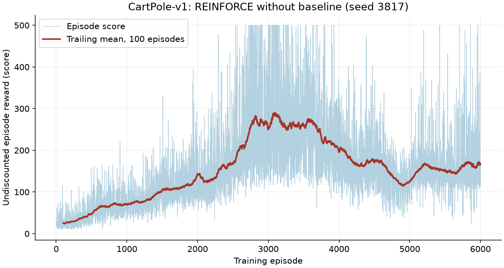
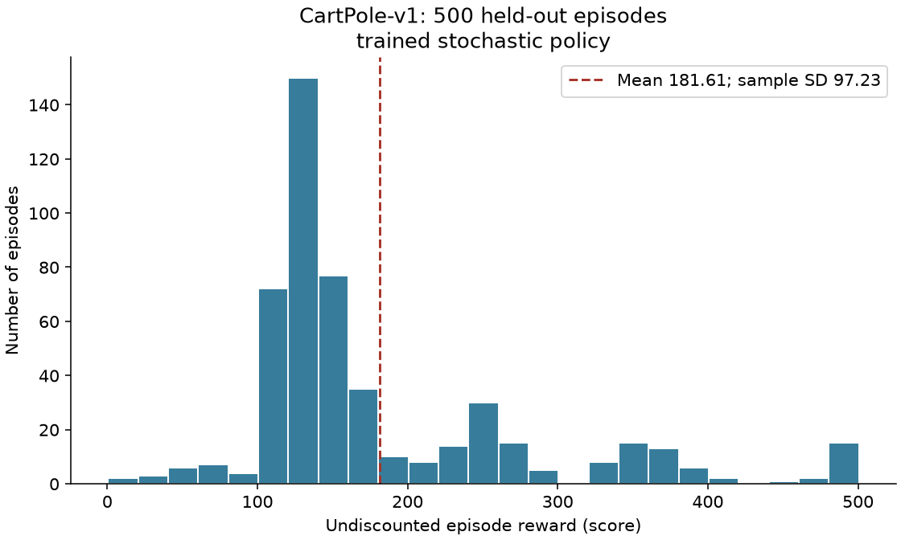
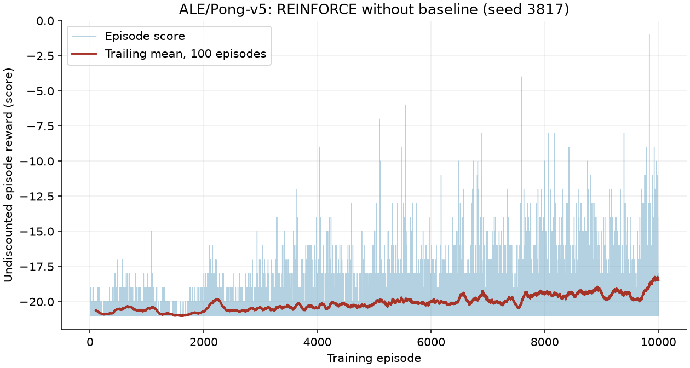
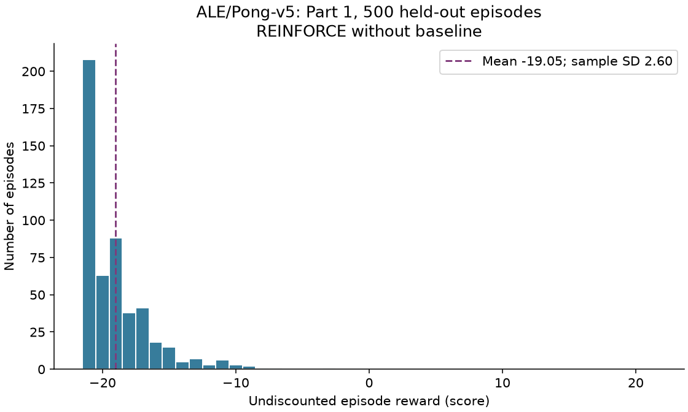

# Policy Gradient: Part 1

GitHub username: **EvelynXuNU**. Repository: **iems_HW1**.
Source and experiment evidence: <https://github.com/EvelynXuNU/iems_HW1>.

The implementation is PyTorch episodic REINFORCE with Adam. Both CartPole-v1
and Pong-v5 training and their required 500-game evaluations are complete.
It has **no baseline, return centering, advantage normalization, critic,
entropy bonus, reward clipping, or point-boundary resets**. Part 2 remains a
separate experiment.

## Objective and gradient

For one episode of length T, the objective is

\[
J(\theta)=\mathbb E_{\pi_\theta}\left[\sum_{t=0}^{T-1}\gamma^t r_t\right].
\]

Define the reward-to-go recursively, starting from zero after the last observed
reward:

\[
G_t=r_t+\gamma G_{t+1},\qquad G_T=0.
\]

For B complete episodes collected under the same policy parameters, minimize

\[
L(\theta)=-\frac1{Bc}\sum_{i=1}^{B}\sum_{t=0}^{T_i-1}
\gamma^t G_{i,t}\log\pi_\theta(a_{i,t}\mid x_{i,t}).
\]

Returns are detached from the gradient. The positive, fixed scale c is 20 for
CartPole and 1 for Pong. It changes gradient units, without subtracting anything
from rewards or altering the objective's optimum. With Adam's epsilon, changing
scale is not perfectly equivalent to changing the learning rate; it is recorded
as a hyperparameter. Episodes are averaged, and action terms within an episode
are summed. Dividing each episode by its length would give a different weighting
of trajectories. No parameters change while collecting a batch. Log probabilities
are recomputed from saved observations and actions before the optimizer step,
with no dropout or other stochastic layers. Computation is split into chunks
of at most 1,024 observations to bound GPU memory, while retaining all decisions.

The outer gamma^t matters for the specified start-of-episode discounted objective.
Using only G_t generally gives a different estimator. The exact enumeration
experiment below deliberately distinguishes the two. Reward-to-go removes past
rewards whose expected score-function gradient is zero; this follows causality
and does not introduce an action-independent baseline.

## Environments and policies

| Setting | CartPole | Pong |
|---|---|---|
| Environment | CartPole-v1 | ALE/Pong-v5, the modern namespaced Pong-v5 |
| Discount | 0.95 | 0.99 |
| Observation | All four state coordinates, unmodified | Consecutive preprocessed game frames |
| Network | 4 -> 64 tanh -> 2 logits | 6,400 -> 64 ReLU -> 2 logits |
| Action sampling | Categorical, actions 0 and 1 | Categorical indices 0 and 1 mapped to actions 2 and 3 |
| Batch | 16 complete episodes | 16 complete episodes |
| Adam rate | 0.003, after training-only pilots | 0.01; weak final performance discussed below |
| Training budget | 6,000 episodes, fixed before final evaluation | 10,000 completed episodes |

Both networks start close to a uniform action distribution. Training and required
evaluation sample actions from the stochastic policy; greedy evaluation is not
silently substituted. Evaluation runs with frozen weights and distinct reset and
action-sampling seeds. Training seed is 3817; evaluation reset seeds begin at
1,500,000,000. A shared reset seed does not make two different policies follow
the same trajectory. The random reference is evaluated separately.

Pong uses RGB images, the assignment's crop, factor-two downsampling, background
removal, and binarization. A copy is made before changing pixels, so the emulator's
observation is not mutated. The policy input is current binary image minus the
previous binary image, flattened. Values are -1, 0, and 1, conveying motion;
the first input of each episode is zero and the previous frame is cleared at
reset. This is a compact partial-observation representation, not a claim of a
fully observed Markov state. No frames from a previous game leak into a new one.

The v5 defaults are preserved: four emulator frames per decision and sticky
action probability 0.25. No additional frame-skip wrapper, FIRE action, no-op
warmup, reward reshaping, or life-based episode segmentation is applied. Only
environment actions 2 (RIGHT) and 3 (LEFT) are passed to step. A real-game test
confirms the game starts and finishes with this action restriction. The emulator's
108,000-frame episode limit is retained. Any truncation is recorded and reported
because a truncated game need not have a final winner. These settings follow
the [official Pong specification](https://ale.farama.org/environments/pong/).

## CartPole results and required plots

The learning-rate pilots each ran 3,000 episodes with the same training seed and
other settings. Selection used training data, before held-out evaluation:

| Adam learning rate | Last 100 training scores: mean | Last 500: mean |
|---:|---:|---:|
| 0.01 | 95.82 | 164.344 |
| 0.003 | 252.87 | 246.052 |
| 0.001 | 82.08 | 78.202 |

The smaller rate 0.003 gave the best late-training scores in this limited pilot,
so it was used for a fresh, fixed 6,000-episode final run. This is a single-seed
hyperparameter comparison, not evidence that 0.003 is universally best. The final
100 training scores averaged 166.72, showing that even this rate does not eliminate
performance degradation. No best-looking checkpoint was selected after evaluation.
For the primary seed, the best 100-episode training window averaged 290.36 and
ended at episode 3,097, whereas the final 100 averaged 166.72. More training did
not reliably improve this run.



**Figure 1.** Raw undiscounted episode rewards, with a trailing mean over exactly
100 complete episodes. The mean first appears at episode 100, with no padded or
centered window. Full episode scores and discounted returns are in training.csv.



**Figure 2.** The frozen final stochastic policy evaluated for 500 episodes.

| Evaluation policy | Episodes | Mean score | Sample SD | Approximate 95% interval for mean |
|---|---:|---:|---:|---|
| Final trained policy | 500 | 181.612 | 97.2304 | [173.0894, 190.1346] |
| Uniform random | 500 | 22.140 | 12.7489 | [21.0225, 23.2575] |

The reported SD uses ddof=1; population SD is also saved. Trained scores ranged
from 20 to 500. Exactly 15 of 500 episodes reached the 500-step limit (3%);
485 ended in physical failure. The policy improves substantially over random,
but **does not solve CartPole reliably**. Its mean discounted return is 19.90266,
versus 12.55544 for random. The score histogram exposes variability hidden by a
near-saturated discounted objective. Confidence intervals describe evaluation
sampling variation for this checkpoint, not training variation across seeds.

Two additional training seeds used the same settings and budget, with 500 frozen
evaluation episodes each. The predeclared primary seed remains 3817.

| Training seed | Evaluation games | Mean score | Episode-score sample SD | Games reaching 500 |
|---:|---:|---:|---:|---:|
| 3817 (primary) | 500 | 181.612 | 97.2304 | 15 |
| 3818 | 500 | 131.218 | 23.3961 | 0 |
| 3819 | 500 | 174.812 | 59.8051 | 0 |

The mean of these three checkpoint means is 162.5473; their sample SD is 27.3442.
This between-run SD differs from the episode-score SD of a fixed checkpoint.
All three improve over the recorded uniform reference, but none is a dependable
500-step policy. Initialization/action seeds differ; reset-seed banks overlap,
so the three-run summary is descriptive rather than an independent-seed
confidence statement. Test results were not used to select a replacement seed.

## Pong results and required plots



**Figure 3.** All 10,000 training episodes, with raw scores and the exact trailing
100-episode average. The first 500 scores averaged -20.742, and the last 500
averaged -19.142. The last 100 averaged -18.46. These are descriptive training
comparisons involving changing policies, not held-out estimates of one policy.



**Figure 4.** The final frozen stochastic policy over 500 official held-out games.
Its mean score is **-19.046**, sample SD **2.5987**, approximate 95% interval for
the mean **[-19.2738, -18.8182]**, and range **-21 to -3**. It won **0/500** games;
all 500 terminated naturally and none truncated. Exactly 208 games ended at -21.
The policy learned to score more often, but it did not learn to win Pong.

The final training-batch action entropy was 0.1065 nats, compared with ln(2)
approximately 0.6931 for a uniform binary policy. Poor scores combined with low
entropy motivate checking premature action concentration; they do not prove
that this caused the failure. A high-value next tuning experiment is matched,
training-only learning-rate pilots at 0.01, 0.003, and 0.001, inspecting scores,
discounted returns, and entropy. These smaller rates are untested candidates,
not demonstrated fixes. Evaluation data must remain outside that selection.

### Fresh fixed-policy diagnostic controls

Existing independent controls used 64 fresh games per policy, reset seeds starting
at 1,600,000,000, and independent per-episode action streams. Weights were frozen;
these games were not used for training or checkpoint selection.

| Policy | Diagnostic games | Mean score | Sample SD | Wins |
|---|---:|---:|---:|---:|
| Final trained policy | 64 | -18.6563 | 2.9343 | 0 |
| Uniform random | 64 | -20.5781 | 0.7304 | 0 |
| Always RIGHT | 64 | -21.0000 | 0 | 0 |
| Always LEFT | 64 | -21.0000 | 0 | 0 |

These controls support limited learning beyond simple reference policies, while
showing no winning policy. They remain separate from the required 500-game
evaluation: their scores are not pooled into its histogram or summary. Raw
diagnostic scores and summaries are in results/q2/verifier/pong_controls.csv and
pong_controls.json. Reproduce them with `python verify_q2_pong_controls.py`.
The optional 500-game random Pong reference was omitted to reduce runtime;
this smaller, clearly labeled diagnostic supplies a direct comparison.

## Edge cases and quantitative validation

Run `python validate_q2.py --pong`. Evidence is saved under results/q2/validation,
including CSV comparisons and first-ten-step traces. These experiments test
predicted behavior, independently check the objective, and expose task limitations.

1. **Exact multistep gradient.** Enumerate all eight trajectories in a three-step
   decision tree. Early actions affect later states and rewards, including
   negative rewards. Differentiate the exact expected discounted return directly,
   and compare it with the probability-weighted REINFORCE estimator. Across all
   seven state logits, maximum disagreement is 2.78e-17. Omitting outer discounting
   gives error 0.21854. This checks temporal credit and the stated objective,
   rather than relying on visual improvement in a noisy curve.

2. **Learning where the optimum is known.** In a one-step stochastic task, action
   reward probabilities are 0.2 and 0.8. Starting uniformly, the same categorical
   loss with Adam 0.01 learns best-action probabilities 0.97787, 0.97897, and
   0.97974 in three independent runs. Exact expected rewards are 0.78672--0.78784,
   versus 0.5 for random. This tests exploration, gradient sign, and learning under
   noisy rewards without relying on the complex game environment.

3. **Discount limits, delayed and signed rewards.** For rewards [1,-2,3] and
   gamma=0.5, reward-to-go is [0.75,-0.5,3] and gradient weights are
   [0.75,-0.25,0.75]. At gamma=0 only the first action receives credit; at gamma=1
   the undiscounted future sums are recovered. A zero-reward episode gives exactly
   zero gradient without division by zero. Punishing action 1 decreases its
   probability from 0.5 to 0.49500 after one Adam step. Very large logits remain
   finite through categorical log probabilities, without manually taking log(0).

4. **Sparse Pong rewards and point boundaries.** For [1,0,-1], gamma=0.99 gives
   returns [0.0199,-0.99,-1], demonstrating that the next point's outcome is
   retained. A reward delayed 1,000 steps gives every earlier eligible action
   weight 0.99^1000 = 4.3171e-5. Discount is never reset when a point is scored.
   Float64 return calculations preserve these small values longer; they cannot
   prevent genuine vanishing credit over long games. At step 5,000 the absolute
   discount is approximately 1.50e-22. This is a limitation of the specified
   start-discounted objective, not a reason to silently train on a different one.

5. **CartPole physics and reset reproducibility.** Independent one-step
   cart-pole equations agree with the environment within 1.71e-9. Repeating an
   episode with identical reset and action RNG seeds reproduces observations
   and actions exactly. The first-ten-step JSON records state, action probability,
   action, reward, next state, reward-to-go, and gradient weight. A uniform-policy
   100-episode check averages 21.54 points (SD 10.8901), consistent with the larger
   independent reference evaluation above.

6. **Termination versus truncation.** The collector stops after either flag,
   retains the last reward, and resets before another action. A diagnostic
   one-step CartPole TimeLimit ends by truncation, with length and return exactly
   one. This deliberately modified environment is used only in validation. The
   assignment run keeps CartPole-v1's 500-step cap. With a complete episodic
   Monte Carlo objective over the observed game, no critic bootstrap is added at
   the cap. Pong truncations are counted separately from completed wins/losses.

7. **Pong pixels, motion, actions, and a full real game.** A synthetic frame has
   exactly one surviving foreground pixel after preprocessing; the original
   input remains unchanged. Moving it produces one -1 and one +1 motion pixel,
   and a fresh episode produces zero motion. A full real v5 rollout using only
   actions 2/3 terminates after 888 decisions with agent/opponent points 0/21,
   hence score -21. Points occur at decisions 63 through 887; their signed
   rewards and gradient weights are saved. The action labels, frame skip, and
   sticky-action probability are checked against the actual emulator.

8. **Interruption and replay.** Compare a 16-episode CPU training run with an
   identical run stopped after episode eight and resumed from its checkpoint.
   All episode scores, lengths, and terminal flags agree and the maximum
   parameter difference is exactly zero. Optimizer state, action RNG state,
   episode count, and explicit reset seeds preserve the experiment. This is
   same-device evidence; cross-device bitwise equivalence is not assumed.
   The same interruption experiment also passed on Deepdish5's RTX PRO 5000 GPU,
   with exactly zero parameter difference. Its independent validation evidence
   is saved under results/q2/deepdish/validation.
   The GPU identity and one-device visibility were verified; server-specific
   selection details are in DEEPDISH.md.

9. **Learning stability and frozen evaluation.** The three learning-rate pilots
   expose late-training instability rather than hiding it behind a peak score.
   The final evaluation keeps weights fixed, samples the trained stochastic
   policy, uses 500 held-out reset seeds, and compares against a 500-episode
   uniform reference. Evaluation data were not used to choose the learning rate.
   The three completed CartPole seeds and fresh frozen Pong controls above
   add task-specific evidence. Broader independent seed replication is still
   needed to estimate training reliability.

10. **Independent completed-run audit.** Existing evidence verifies all four
    evaluation checkpoint hashes, the 10,000 Pong episodes and 625 updates, and
    disjoint training/evaluation reset ranges. The first 5,376 episode records
    and 336 updates exactly match the archived serial run; its checkpoint hash
    matches continuation metadata. Part 1 has no baseline state. An independent
    variable-length finite-difference gradient check agrees within 1.57e-11, and
    the production chunked Adam update agrees with an unchunked update within
    9.32e-10 in parameters. Serial/batched partial Pong trajectories and
    score-only reset handling agree, and the first two official GPU evaluation
    games replay exactly on CPU, including lengths and ending flags. This
    evidence is preserved under results/q2/verifier; it was incorporated without
    repeating training. Reproduce the mathematical/update checks with
    `python verify_q2_independent.py`, and the completed Pong collector replay
    with `python verify_q2_completed_collector.py`.

For CartPole's constant reward, a 100-step episode already has discounted return
19.88159, while a 500-step episode has return almost exactly 20. Thus gamma=0.95
strongly compresses differences between medium and long survival. This helps
explain why a mathematically correct estimator can improve discounted return
without reliable 500-step scores. A rising curve alone would not have revealed
that distinction. Similarly, Pong's sparse rewards, partial observation, sticky
actions, and negative early scores make baselineless Monte Carlo gradients noisy.

## Execution and reproducibility

Use Python 3.11+ with requirements-q2.txt. The tested local environment used Python
3.13.13, PyTorch 2.15.0, Gymnasium 1.4.0, ALE 0.12.1, NumPy 2.5.4, and Matplotlib
3.11.2. Every run saves its actual versions and configuration. Deepdish should use
a compatible CUDA-enabled PyTorch installation and expose exactly one GPU.
See README.md and DEEPDISH.md for complete commands and output locations.

This report covers Policy Gradient Part 1. The shuttle and baseline experiments
are documented separately. All experiment source, figures, CSVs, metadata, and
independent verification code are published in the repository identified above.

The serial/batched transition changes the action RNG protocol. To reproduce the
reported two-stage Pong experiment on one assigned GPU from a fresh directory:

```bash
python q2_policy_gradient.py train --game pong --episodes 5376 --lr 0.01 \
  --reward-scale 1 --device cuda --output-dir results/q2/pong/reproduction
python fast_pg.py train --part 1 --game pong --episodes 10000 --lr 0.01 \
  --reward-scale 1 --batch-episodes 16 --workers 8 --save-every 4 --device cuda \
  --resume results/q2/pong/reproduction/checkpoint.pt \
  --output-dir results/q2/pong/reproduction
python fast_pg.py evaluate --checkpoint results/q2/pong/reproduction/checkpoint.pt \
  --episodes 500 --workers 8 --device cuda \
  --output-dir results/q2/pong/reproduction/evaluation_trained
```

Set CUDA_VISIBLE_DEVICES to the one assigned card and
CUBLAS_WORKSPACE_CONFIG=:4096:8 before CUDA execution. Use the recorded package
versions for the closest replay; cross-device bitwise agreement is not assumed.
To reproduce the continuation without repeating the first stage, copy the
archived checkpoint at legacy_snapshots/through_episode_5376/ to a new run
directory, then use the last two commands with that checkpoint path. A fresh
10,000-episode serial run would use a different action stream after episode 5,376
and is not an exact reproduction of this experiment.

### Recorded runtime continuation

After episode 5,376, the Part 1 checkpoint, source, and logs were archived and
training resumed with a validated batched collector. Eight CPU workers feed one
GPU, complete all 16 trajectories under fixed policy parameters, and then perform
the same actor update. In an isolated remote benchmark all 32 game scores and
lengths matched across serial CPU/GPU and batched collectors; actor updates also
matched in worker-count validation. The new action RNG protocol and source hashes
are recorded. The continuation is statistically on-policy, but is not a claim of
bitwise replay of the legacy serial action stream. Training completed at
10,000 episodes and frozen evaluation at 500; the optional random reference was
omitted. Checkpoints now save every 64 episodes and at completion. See DEEPDISH.md
and results/q3/collector_benchmark_deepdish.json for timing and validation evidence.

## With three additional months

**Month 1: estimator and optimization reliability.** Repeat training with at
least five independent seeds for every main setting. Predeclare episode budgets,
pilot/evaluation seed splits, and learning-rate comparisons. Compare batch sizes
and fixed reward scales while checking the exact objective and gradient direction.
Report distributions of final evaluation performance and wall-clock/sample cost,
not just the best run. Extend exact-gradient enumeration to variable-length
episodes and independently compare finite differences. Check CPU versus single-GPU
agreement and resumed versus uninterrupted training on the actual GPU backend.

**Month 2: observation and environment sensitivity.** Within Pong-v5 compare
frame differences with two-frame stacks and compact convolutional policies under
matched budgets. Keep v5 sticky actions and frame skipping unchanged in required
runs; perform any deterministic or altered-discount variants as explicitly labeled
diagnostics. Study how frame timing, delayed rewards, and truncation frequency
affect learning. For CartPole evaluate recovery from controlled near-boundary
states separately from the official initial-state distribution, including pole
angle and velocity shifts. Test whether high scores persist across resets and
whether the input representation loses useful information.

**Month 3: robustness, variance, and generalization.** Compare Part 1 against
Part 2 baselines using matched seeds, environment settings, and budgets. Measure
gradient variance as well as score variance, and report confidence intervals
across training seeds. Evaluate fixed checkpoints on new, untouched seeds,
including greedy rollouts as a separately labeled secondary measure. Track
Pong point-win probability, action entropy, episode length, and timeouts to
distinguish learning to rally from learning to win. Repeat longer runs to quantify
catastrophic degradation and evaluate checkpoint-selection rules using a separate
validation set without reusing the final 500-episode test set.
