# Policy Gradient: Part 2

This section repeats the two Part 1 experiments with a baseline (20 points:
10 for plots, 10 for edge cases and tests). CartPole training and the required
500-game evaluations are complete, as are the full Pong reference experiment and
its 500-game evaluation. The required baseline explanation, four game-specific
plots, quantitative validation, edge cases, and three-month experiment plan are
included below. Pong failed to learn a winning policy; this limitation remains
explicit in the final results.

| Completed configuration | Training episodes | Evaluation games | Mean score | Sample SD |
|---|---:|---:|---:|---:|
| CartPole, EMA baseline, primary seed | 6,000 | 500 | 438.342 | 95.7679 |
| Pong, EMA baseline, matched reference | 10,000 | 500 | -19.460 | 0.9952 |
| Pong, EMA baseline, CNN follow-up | 4,480 | 500 | -18.492 | 1.8722 |

The first two rows are the required repeated experiments; the CNN is an
additional tuning experiment. Both Pong configurations lost all evaluation games.

## Baseline and implementation

I use an adaptive scalar baseline: a bias-corrected exponential moving average
of **previous batches' episode-start discounted returns**. It is constant across
states, actions, and decision times within the current batch, and changes only
between batches. This is a simple constant baseline rather than a learned critic.
It adds a scalar update, with negligible cost compared with game simulation.

Let \(m_k\) be the mean \(G_0\) among the complete episodes in batch \(k\).
Initialize \(n_0=z_0=0\) and \(b_0=0\). With decay \(d=0.9\), after the actor
update for batch \(k\) compute

\[
n_{k+1}=d n_k+(1-d)m_k,\quad z_{k+1}=d z_k+(1-d),\quad
b_{k+1}=n_{k+1}/z_{k+1}.
\]

The denominator corrects the startup shrinkage toward zero. The next batch uses
\(b_{k+1}\). The current batch uses \(b_k\), fixed before its trajectories are sampled.
Using the old value avoids the finite-sample bias that can arise when a trajectory
helps determine the baseline subtracted from its own return.

The actor still maximizes the assigned episodic objective
\(J(\theta)=\mathbb E[\sum_t\gamma^t r_t]\). Its loss is

\[
L(\theta)=-\frac{1}{Bc}\sum_{i=1}^{B}\sum_{t=0}^{T_i-1}
\gamma^t(G_{i,t}-b_k)\log\pi_\theta(a_{i,t}|x_{i,t}).
\]

The baseline and returns are detached. The fixed scales \(c=20\) for CartPole and
\(c=1\) for Pong match Part 1. No advantage standardization, critic bootstrap,
entropy bonus, pointwise discount reset, or reward reshaping is introduced.
Conditioning on the previous training history and current state, \(b_k\) is fixed,
and \(\mathbb E_a[\nabla_\theta\log\pi_\theta(a\mid s)]
=\sum_a\nabla_\theta\pi_\theta(a\mid s)=0\). Thus subtracting \(b_k\) leaves the
expected gradient unchanged, including when episodes end at different times.
It can change variance and individual optimizer steps, as intended.

A return-average baseline is not generally variance optimal; this is a known
limitation of baseline control variates, discussed by
[Greensmith, Bartlett, and Baxter (2004)](https://www.jmlr.org/papers/v5/greensmith04a.html).
I measure the effect directly, rather than infer it from a smoother reward plot.
The exact counterexamples below also identify when this simple choice can fail.

All actor settings match Part 1: CartPole-v1 gamma=0.95 and Adam=0.003;
ALE/Pong-v5 gamma=0.99 and Adam=0.01; 64 hidden units, two output logits,
16 complete episodes per update, stochastic actions, and the same fixed reward
scales. Pong retains the 80x80 frame differences, actions 2/3 only, v5 frame skip
4, sticky-action probability 0.25, and the official episode limit. CartPole has
6,000 completed training episodes; Pong has 10,000. Every run starts from
a fresh policy, rather than warm-starting Part 2 from the Part 1 trained network.

## CartPole results

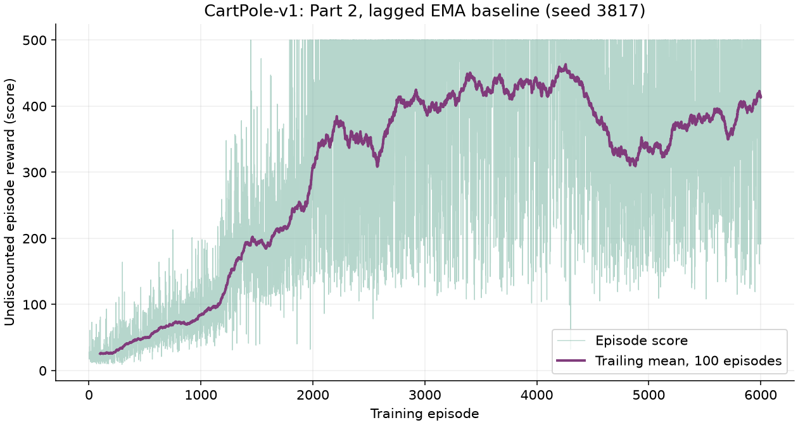

**Figure 1.** Primary training seed 3817. The trailing mean uses exactly 100
episodes and starts at episode 100. No shortened or padded window is shown.

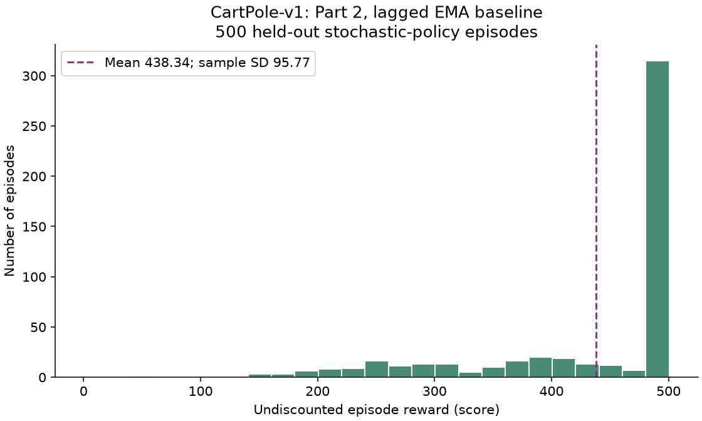

**Figure 2.** Frozen final stochastic policy, with 500 held-out episodes. The mean
is **438.342**, sample SD **95.7679**, and approximate 95% interval for this
checkpoint's mean **[429.9476, 446.7364]**. Scores range from 46 to 500.
303/500 episodes reach 500 (60.6%). The policy improves substantially over Part 1,
but is not reliably perfect. The test set was not used to select a checkpoint,
baseline decay, or learning rate.

Three matched training initialization/action seeds give the following results.
Each row uses a fixed 6,000-episode training budget and 500 evaluation games.

| Seed | Part 1 mean | Part 1 sample SD | Part 2 mean | Part 2 sample SD | Part 2 fraction reaching 500 |
|---:|---:|---:|---:|---:|---:|
| 3817 | 181.612 | 97.2304 | 438.342 | 95.7679 | 0.606 |
| 3818 | 131.218 | 23.3961 | 434.470 | 102.0657 | 0.602 |
| 3819 | 174.812 | 59.8051 | 388.232 | 104.6479 | 0.304 |

The mean of the three final evaluation means increases from 162.5473 to 420.3480.
The sample SD across those three means is 27.3442 for Part 1 and 27.8806 for
Part 2. Thus this small replication supports improved scores, not reduced
between-training variability. It also demonstrates that smaller **gradient**
variance need not mean smaller **episode-score** SD: seed 3818's score SD rises.
The training seeds use different initialization and action streams, but their
reset-seed banks overlap. These are descriptive paired comparisons; no claim of
an independent-seed confidence interval or universal baseline superiority is made.
Termination and truncation flags may both be true on the same final transition;
the saved counts are not assumed mutually exclusive.

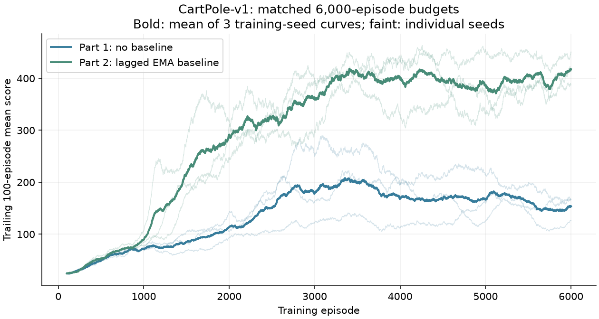

**Figure 3.** Equal training budgets, with all three seeds retained. Bold curves
average the three trailing means; faint curves show individual training runs.

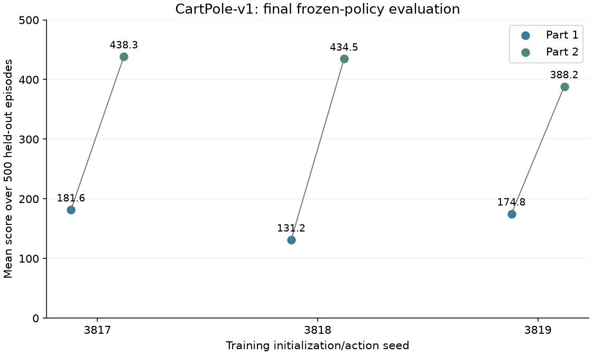

**Figure 4.** Each point is one frozen checkpoint's mean across 500 evaluation
episodes. This preserves training-seed differences rather than pooling 1,500
games and treating them as one independently trained policy.

## Gradient-variance experiments

At each frozen policy, estimate the baseline on independent calibration games,
freeze it, then compute both gradient estimates on the **same** probe trajectories.
Measure the trace of the sample gradient covariance with ddof=1. Policies and
observations are identical within each pair. Thus the comparison isolates the
baseline, rather than confounding it with an already improved policy.

| Frozen policy | Calibration / probe episodes | Baseline | Raw gradient variance | Baseline gradient variance | Ratio and paired-bootstrap 95% interval |
|---|---:|---:|---:|---:|---|
| Initial CartPole | 64 / 128 | 13.1001 | 0.97880 | 0.94067 | 0.9610 [0.7148, 1.2498] |
| Final Part 1 CartPole | 64 / 128 | 19.9725 | 18.08717 | 0.30767 | 0.01701 [0.0000615, 0.05208] |
| Initial Pong | 32 / 32 | -1.44340 | 124.50566 | 15.40717 | 0.12375 [0.09414, 0.16511] |

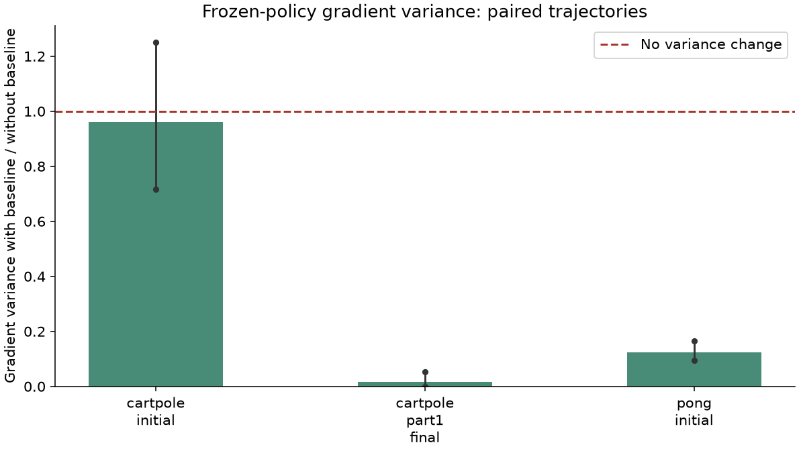

**Figure 5.** Ratios below one indicate variance reduction. There are 2,000 paired
bootstrap resamples; both estimators use the same trajectory indices in every
resample. The initial CartPole result is inconclusive. The final CartPole policy
shows about 98.3% reduction, and initial Pong about 87.6%. These intervals are
conditional on the chosen frozen policy and fitted baseline, and do not include
training-seed or baseline-fitting uncertainty. Pong's small sample warrants
replication. Absolute variances across games should not be compared because
parameter dimensions and reward scales differ.

## Edge cases and further validation

Run `python validate_q3.py --variance --pong`. The validation JSON and CSV files
under results/q3/validation preserve all predictions and measurements.

1. **Exact baseline invariance.** Enumerate eight three-step trajectories and
   differentiate the exact expected discounted reward directly. Constant baselines
   -10, 0, and 5 leave the expected REINFORCE gradient unchanged to below 1e-12.
   A separate five-trajectory example ends immediately after one root action,
   exercising variable episode length and termination. It also agrees below
   1e-12. An intentionally action-dependent baseline changes the gradient by
   0.24026 in the fixed-length example, demonstrating that the experiment detects
   invalid baseline dependencies.

2. **Same-batch centering bias.** In an exactly enumerated Bernoulli bandit with
   p=0.3 and reward equal to action, the true gradient is 0.21. Subtracting the
   current batch's mean reward gives expected gradient 0 for batch size one and
   0.1575 for size four, the factor (1-1/B). Our previous-batch update avoids this
   dependency. This is why the baseline update order is part of the algorithm.

3. **Known variance reductions and failures.** For deterministic rewards and
   p=0.3, the no-baseline gradient variance is 0.1029; the return-mean baseline
   reduces it to 0.0336, and the variance-optimal constant reduces it to numerical
   zero, while preserving gradient 0.21. In a noisy bandit with p=0.98, the mean
   baseline increases variance from 0.00401690 to 0.00963881. A baseline is not an
   automatic guarantee of improvement. This counterexample motivates measuring
   the actual frozen-game gradient variance rather than asserting all baselines
   reduce it.

4. **Startup, zero rewards, negative rewards, and discount limits.** The first
   batch uses zero, so the first actor update must match Part 1. A first baseline
   target of 20 yields 20 after startup correction. Repeated zero targets keep
   b=0 without dividing by a sample SD; negative targets yield a negative baseline.
   With gamma=0, only the first decision receives gradient credit. A positive
   reward below the baseline correctly decreases the sampled action's probability.
   A stale nonzero baseline can add noise even when all current rewards are zero:
   the exact zero-reward example has expected gradient zero but variance 0.84.
   Returns are detached, and the baseline is never differentiated through the actor.

5. **Learning with a known optimum.** In the noisy 0.2-versus-0.8 reward bandit,
   three training seeds learn best-action probabilities 0.98007, 0.97784, and
   0.97948. Corresponding exact expected rewards are approximately 0.787--0.788,
   versus 0.5 for uniform actions. This checks that the lagged-baseline loss and
   update order still learn under stochastic rewards.

6. **Replay and a controlled first update.** A 16-episode run stopped after eight
   episodes and resumed exactly reproduces the uninterrupted policy, all episode
   records, baseline state, and optimizer diagnostics. Part 1 and Part 2's first
   zero-baseline batch also produce exactly identical policy parameters. GPU
   replay is validated once before Part 2's remote run, with a cache keyed by
   source, software environment, and GPU identity.

7. **Environment and runtime edge cases.** Part 1's action mapping, official
   versions, frame-history resets, final rewards, and termination/truncation
   handling are reused. The new batched collector preserves every complete
   episode, including slow games; it does not restart early-finishing games to
   fill a batch. One-versus-four-worker Pong trajectories and actor updates match
   exactly. Repeated resets and a partial final batch match the reference.
   A score-only 17-game evaluation records exactly 17 games. Fast training replay
   reproduces parameters exactly even when the number of CPU workers changes.
   Continuing an old checkpoint preserves its prior episode history.

8. **Audit of the completed runs.** `python verify_q3_completed.py` independently
   reconstructs every EMA from saved returns, without importing the training
   implementation or running any games. Across three CartPole runs, the Pong
   reference, and the selected CNN, all 2,030 actor updates agree within
   1.43e-14. It checks 80 saved decision records, recomputes all five 500-game
   score summaries, checks nonoverlapping training/evaluation reset banks, and
   matches each evaluation's checkpoint SHA-256. Evidence is in
   results/q3/verifier/completed_artifact_audit.json. This verifies consistency
   of saved evidence; algorithmic correctness is supported separately by the
   exact-gradient, variance, learning, and replay experiments above.

### Ten-step credit-assignment example

For the first CartPole episode after the initial batch, the baseline is
13.6720064, computed from the preceding 16 episodes. The initial state
(cart position, velocity, pole angle, angular velocity) is approximately
(-0.001779, -0.042984, -0.007022, -0.012988). Every displayed reward is +1.
The policy stays fixed throughout the episode; its probabilities change because
the state changes. The last column is gamma^t(G_t-b)/20, before averaging over
the 16 episodes in the actor update.

| Step | Pole angle | Action | P(action) | G_t | G_t-b | Weight |
|---:|---:|---:|---:|---:|---:|---:|
| 0 | -0.00702 | 0 | 0.5015 | 15.4813 | 1.8093 | 0.09046 |
| 1 | -0.00728 | 1 | 0.5019 | 15.2435 | 1.5715 | 0.07464 |
| 2 | -0.00173 | 0 | 0.5016 | 14.9931 | 1.3211 | 0.05962 |
| 3 | -0.00208 | 1 | 0.5018 | 14.7296 | 1.0576 | 0.04534 |
| 4 | 0.00341 | 0 | 0.5016 | 14.4522 | 0.7802 | 0.03177 |
| 5 | 0.00304 | 1 | 0.5018 | 14.1602 | 0.4882 | 0.01889 |
| 6 | 0.00854 | 0 | 0.5016 | 13.8529 | 0.1809 | 0.00665 |
| 7 | 0.00820 | 0 | 0.4981 | 13.5293 | -0.1427 | -0.00498 |
| 8 | 0.01378 | 0 | 0.4947 | 13.1888 | -0.4832 | -0.01603 |
| 9 | 0.02526 | 1 | 0.5087 | 12.8303 | -0.8417 | -0.02652 |

At step 7 the return falls below the frozen baseline despite a positive immediate
reward, so that decision's contribution discourages its sampled action. The full
update sums contributions from all decisions and episodes; the sign of one term
does not determine the eventual parameter change. Full states, next states,
rewards, and ending flags are in
results/q3/cartpole/final_seed3817/first_10_steps_after_baseline.json.

## Pong reference result and runtime

Pong Part 2 trained a fresh policy for 10,000 episodes on the same single GPU,
using the same actor settings and the lagged scalar baseline. Its final 500-game
stochastic evaluation averaged **-19.460**, with sample SD **0.9952**, approximate
95% interval **[-19.5472, -19.3728]**, and range **-21 to -15**. All 500 games
terminated naturally, none truncated, and **none were wins**.

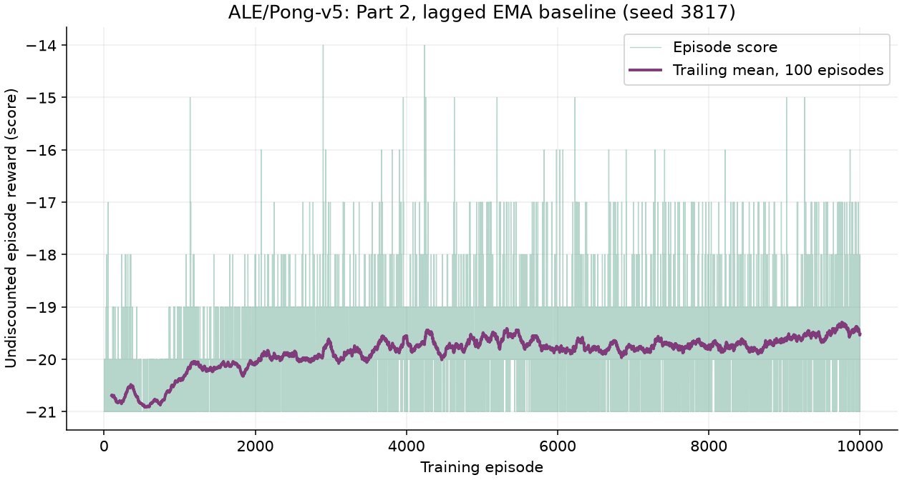

**Figure 6.** The complete Part 2 reference run. Lower gradient variance did not
produce effective game-level learning with these settings.

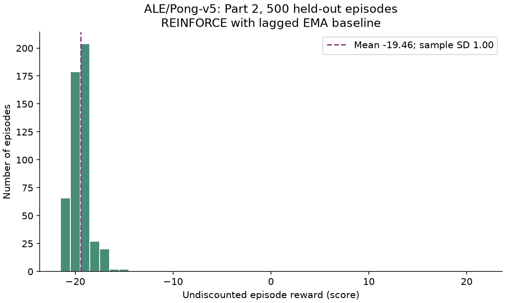

**Figure 7.** The required frozen-model evaluation. Its mean is worse than
Part 1's -19.046. Its discounted return mean, however, is 0.12595 versus Part 1's
-0.26569. Improvement in the assigned discounted objective did not translate to
winning games. This is a failed training configuration, not a successful Pong
model. This failure motivated the controlled training-only experiments reported
below; their checkpoints were selected without using the final test games.

The fast collector uses eight CPU workers and batches inference on one GPU.
A remote fixed-policy benchmark measured 3,007 decisions/second with sequential
CUDA inference versus 13,305 with eight workers, a 4.4x rollout-throughput increase.
All benchmark modes produced identical scores and lengths for 32 games. This is
a collector benchmark, not a guarantee of a 4.4x end-to-end training speedup.
The optional 500-game random evaluation is omitted, while the required trained
evaluation remains 500. Checkpoints are saved every four actor batches (64
episodes) and at completion. This reduces I/O but increases interruption replay
to at most 64 episodes. Changed code/environment/device triggers revalidation.

Part 1's legacy checkpoint and source were archived before its runtime switch.
The new collector uses independent per-episode action RNG streams and records
the transition and source hashes. The mathematical policy and objective are
preserved; bitwise continuation of the old serial sampling stream is not claimed.
This engineering change and single-seed Pong comparison limit causal conclusions.

## Execution and reproducibility

Use the same requirements-q2.txt environment as Part 1. Typical local commands:

```bash
python validate_q3.py --variance --pong
python validate_fast_pg.py
python verify_q3_completed.py
python compare_policy_gradients.py
python q3_policy_gradient.py train --game cartpole --episodes 6000 --lr 0.003 \
  --output-dir results/q3/cartpole/reproduction
python q3_policy_gradient.py evaluate \
  --checkpoint results/q3/cartpole/reproduction/checkpoint.pt \
  --episodes 500 --output-dir results/q3/cartpole/reproduction/evaluation_trained
```

Reproduce the matched Pong reference from a fresh policy and output directory:

```bash
python fast_pg.py train --part 2 --game pong --episodes 10000 --lr 0.01 \
  --reward-scale 1 --batch-episodes 16 --workers 8 --save-every 4 --device cuda \
  --output-dir results/q3/pong/reproduction
python fast_pg.py evaluate --checkpoint results/q3/pong/reproduction/checkpoint.pt \
  --episodes 500 --workers 8 --device cuda \
  --output-dir results/q3/pong/reproduction/evaluation_trained
```

Before CUDA execution, set the following variables, replacing the quoted GPU
identifier with your one assigned card:

```bash
export CUDA_VISIBLE_DEVICES="your-assigned-GPU-UUID"
export CUBLAS_WORKSPACE_CONFIG=:4096:8
```

On a CPU-only machine use `--device cpu` in both commands; timings and
floating-point trajectories can differ. The baseline
defaults to the documented lagged EMA with decay 0.9. Additional CartPole seeds
use `--seed 3818` and `--seed 3819` in separate output directories.

The Part 2 checkpoint includes the policy, Adam state, baseline numerator/mass,
action RNG, and completed history. Resume requires matching parameters. The
Deepdish command, dependency queue, and monitoring paths are in DEEPDISH.md.
Both reference experiments now have their required Pong figures and statistics.
They remain reproducible evidence of limited learning, alongside the much
stronger CartPole results. Any improved experiment must be labeled separately.

## Budgeted Pong follow-up

A separate 29.8-minute single-GPU campaign screened lower learning rates and
current-frame-plus-motion observations. The selected model used two convolution
layers (16 and 32 filters, kernel 5, stride 2), a 64-unit hidden layer, Adam
0.001, and the same lagged EMA baseline. It trained for 4,480 episodes before the
budget stop. The checkpoint was selected using training scores only, then frozen
for 500 games on a new seed bank beginning at 1,900,000,000.

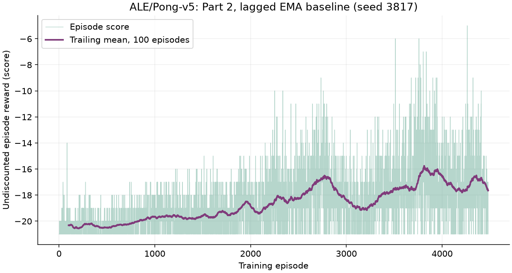

**Figure 8.** The budget-limited CNN follow-up. Its current-frame channel retains
foreground even when frame differences are zero. The baseline and assigned
discounted objective are unchanged.

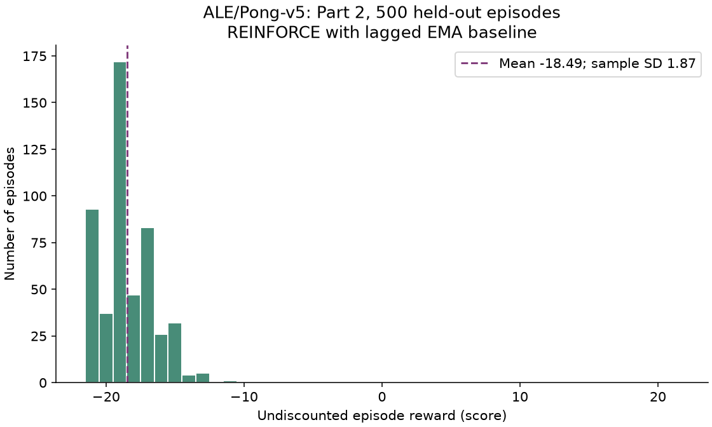

**Figure 9.** Mean score -18.492, sample SD 1.8722, approximate 95% interval
[-18.6561, -18.3279], range -21 to -11. All games ended naturally, with no
truncations, and **0/500 were wins**. This improves scoring over the Part 2
reference's -19.460 but does not resolve the winning-performance failure.
Architecture, observations, learning rate, and budget differ from the reference;
this is a tuning follow-up, not an isolated test of the baseline's effect.

The complete screening table, selection rule, validation, source snapshots,
checkpoint, and remaining limitations are documented in PONG_TUNING.md and
results/pong_tuning. Smaller rates alone did not improve the short difference-only
pilots. New observations helped early training, but recent training scores were
optimistic relative to the final frozen evaluation. No successful Pong agent or
robust multi-seed improvement is claimed. GPU work finished within the campaign
budget; no further experiment was queued.


## Internet-informed PPO performance follow-up

Within a separate 20-minute budget, I tested a different policy-gradient approach
on Deepdish: Stable Baselines3 PPO-Clip with a learned state-value baseline,
GAE, normalized advantages, multiple minibatch updates, and clipping. The
[original PPO paper](https://arxiv.org/abs/1707.06347) and
[OpenAI explanation](https://spinningup.openai.com/en/latest/algorithms/ppo.html)
motivate limiting policy changes. The
[SB3 documentation](https://stable-baselines3.readthedocs.io/en/master/modules/ppo.html)
recommends CPU execution for small MLPs; both trials therefore used Deepdish CPUs.
Pong adds image-derived object/motion features, motivated by
[object-centric Atari research](https://arxiv.org/abs/2306.08649).

This is a supplemental algorithm comparison, not the required basic REINFORCE
experiment. It retains the assigned discounts, official environments, and Pong
actions 2/3. No emulator RAM, downloaded pretrained agent, scripted action rule,
reward shaping or Pong point reset was used. RESEARCH_20MIN.md explains the
changes, hyperparameters, source citations, reproduction, and limitations.

| Frozen stochastic policy | Games | Mean score | Sample SD | At cap / wins |
|---|---:|---:|---:|---:|
| CartPole PPO | 500 | 500.000 | 0.0000 | 500/500 at 500 |
| Pong PPO, image-derived features | 500 | -9.772 | 4.0799 | 10/500 wins |

Both improve over their prior Part 2 means (438.342 for CartPole; -18.492 for
the earlier Pong CNN follow-up). The baseline, estimator, architecture, input
representation and budgets differ, so this does not isolate a baseline effect.
Each result is conditional on one training seed. CartPole's observed zero SD
does not imply population certainty: its exact one-sided 95% lower bound on the
probability of reaching the cap is 0.9940.

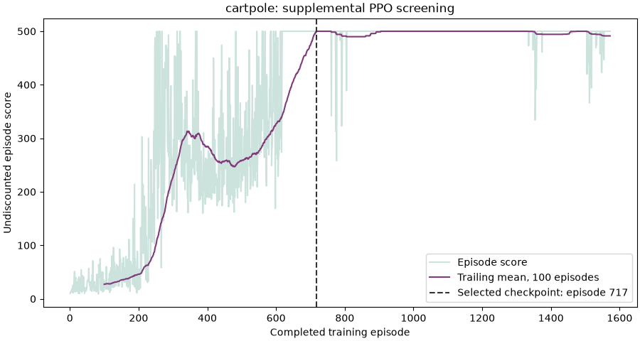

**Figure 10.** Raw PPO CartPole screening scores and exact trailing 100-episode
mean. The vertical line marks training-only checkpoint selection; later training
was retained in the plot but did not determine the frozen test result.

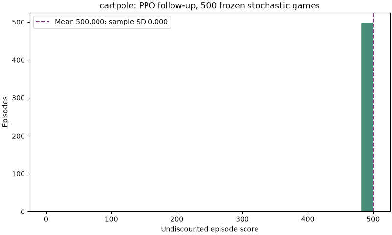

**Figure 11.** All 500 requested seeds reached the official time limit. These
are time-limit truncations, rather than physical failure terminations.

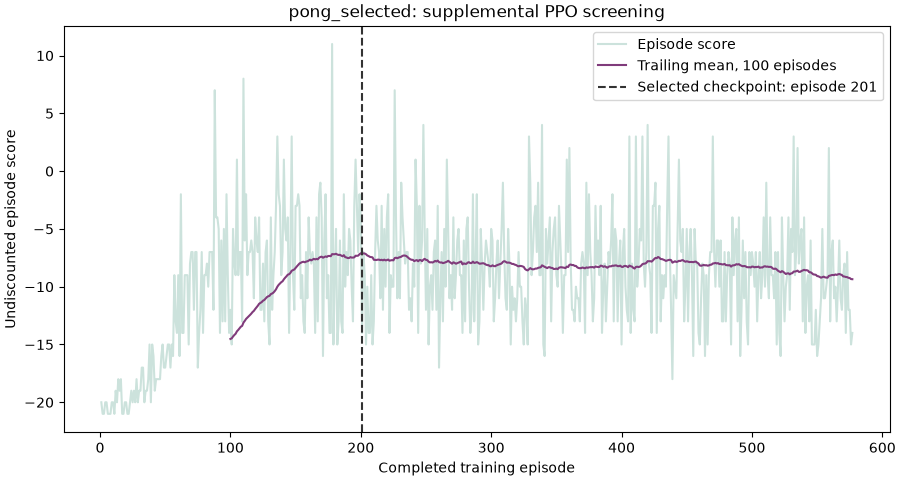

**Figure 12.** PPO Pong screening with 12 pixel-derived features. Its best
trailing training mean was -7.10, versus -8.12 for a shorter second pilot adding
approximate intercept features. The shorter pilot is inconclusive, not evidence
that intercept features cannot help. Selection preceded all final Pong games.

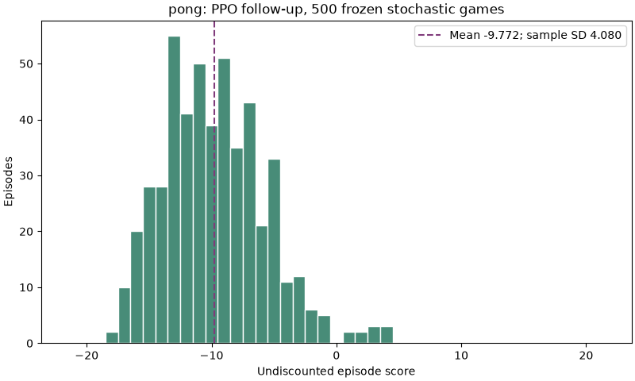

**Figure 13.** Exactly 500 fixed reserved seeds, stochastic learned actions, and
full official games. All requested seeds must finish; faster extra autoreset
games are ignored. The model SHA-256 and training-only selection were audited.
The feature extractor passed synthetic centroid/motion/reset checks and matched
4,135 official Pong transitions under the same actions. Execution used an
isolated dependency directory, preserving the original assignment environment.

The raw-data audit and selection evidence are under results/research20. Run
`python audit_research_results.py` to recompute the statistics and training plots;
`python validate_research_ppo.py` validates feature and environment behavior.

## With three additional months

**Month 1: stronger variance estimates and optimization comparisons.** Repeat
matched experiments with more independent initialization/action streams and
disjoint reset banks. Measure gradients at multiple checkpoints throughout
training, with larger calibration and probe sets. Compare EMA decays and the
gradient-norm-weighted optimal constant using training-only choices. Quantify
baseline-estimation uncertainty as well as conditional probe uncertainty.

**Month 2: richer baselines and controlled failure cases.** Compare the scalar
baseline with time-dependent and learned state-value baselines, fitted on past
or cross-fitted data to avoid using an episode to fit its own baseline. Study
stale baselines after demand/reward changes, negative and all-zero rewards, and
rare early failures. Preserve the official game settings in required runs;
label altered discounts and deterministic variants as diagnostic experiments.

**Month 3: performance, robustness, and efficiency.** Repeat held-out evaluation
across training seeds and inspect learning deterioration, Pong win fractions,
truncations, action entropy, and game lengths. Compare gradient variance,
episode-score variance, and final score separately. Benchmark full update time,
CPU use, GPU utilization, and I/O with confidence intervals, rather than only
collector FPS. Check resumed versus uninterrupted GPU runs and validate any
checkpoint-selection rule on a separate set before the final 500-game test.
